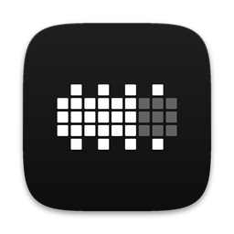
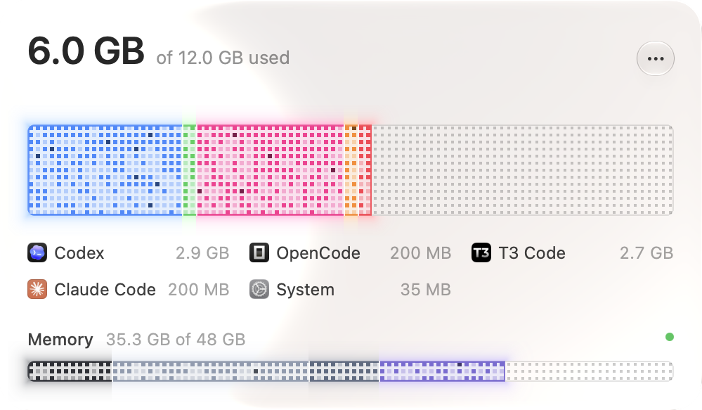

<p align="center">
  
  <h1 align="center">RamDisk for macOS</h1>
</p>

<p align="center">
  RamDisk is a native macOS menu bar app that gives your coding agents a disk in memory, and shows what each agent uses.
</p>

<p align="center">
  
</p>

## Agents

Connect Claude Code, Codex, and OpenCode in Settings. Each connected agent gets the RamDisk MCP server and makes its own workspace folder on the disk for builds, caches, and temporary files. T3 Code works through its Claude Code and Codex sessions.

- Choose a disk size from 1 GB to all the memory in your Mac. The disk takes memory only as it fills.
- See the disk use for each agent, and the memory pressure, in one panel.
- Keep the contents after an eject or a restart, if you turn that on.
- Use the `ramdisk` command line tool for the same actions in a terminal.

## RAM Disk and SSD

Measured on a MacBook Pro with 48 GB of memory, as the median of three runs. A RAM disk also writes nothing to the SSD, so agent builds and caches cause no SSD wear.

| Task | RAM disk against the SSD |
|---|---|
| **Write 2 GB with `fsync`** | **1.8x faster** |
| **Delete 20,000 files** | **1.2x faster** |
| Delete a build folder | 1.1x faster |
| `git clone` | 1.1x faster |
| `swift build` | the same |

## Build

RamDisk needs macOS 26 and Xcode 26.

```sh
xcodegen generate
xcodebuild -project RamDisk.xcodeproj -scheme RamDisk -configuration Release build
```
